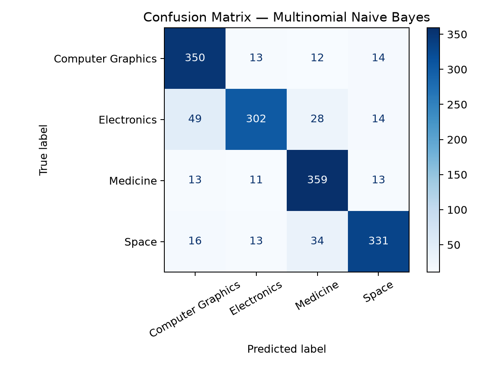

# Model Results

This page contains the outputs from an actual training run of the project.

## Accuracy

| Model | Accuracy |
| --- | ---: |
| Multinomial Naive Bayes | 85.37% |
| Linear SVC | 82.44% |
| Logistic Regression | 82.12% |

**Best model:** Multinomial Naive Bayes (85.37% accuracy)

## Confusion Matrix

## Sample Predictions

| Input | Predicted topic |
| --- | --- |
| NASA is designing a telescope to observe stars and distant galaxies. | Space |
| A graphics engine renders 3D objects using polygons, lighting, and textures. | Computer Graphics |
| Doctors studied symptoms, treatment outcomes, and patient recovery. | Medicine |
| The circuit uses a transistor, resistor, and voltage regulator. | Electronics |
| A medical imaging system analyzes scans to support clinical research. | Medicine |

## Explainability

The file artifacts/top_terms.csv lists the terms with the strongest
positive weights for each class in the selected linear model.

## Notes

The dataset is the public 20 Newsgroups corpus loaded through scikit-learn.
Headers, footers, and quoted replies are removed before training.
